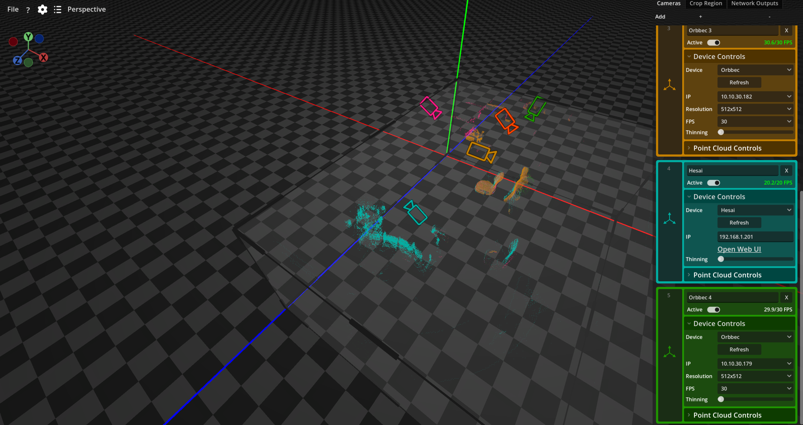

# Carto 0.1.0

Carto est un outil de fusion de données de profondeur qui a été développé pour le projet de recherche en interaction collective de la SAT.

La documentation en anglais et en français se trouve [ici](https://sat-mtl.github.io/Carto/)

## Localisation

marche à suivre pour localiser la documentation

voir https://github.com/google/mdbook-i18n-helpers/blob/main/i18n-helpers/USAGE.md

### Setup
- mettre à jour mdbook `cargo install mdbook`
- installer mdbook i18n helpers `cargo install mdbook-i18n-helpers`
- intaller poedit

### pour mettre à jour le texte
- éditer la version originale dans les fichiers markdown
- rouler `MDBOOK_OUTPUT='{"xgettext": {}}' mdbook build -d po` pour générer une nouvelle version de messages.pot
- rouler `msgmerge --update po/en.po po/messages.pot` pour obtenir une version mise à jour de la traduction
- avec poedit, en éditant le fichier `po/en.po`  passer à travers les nouvelles traductions à faire et celles à modifier.
